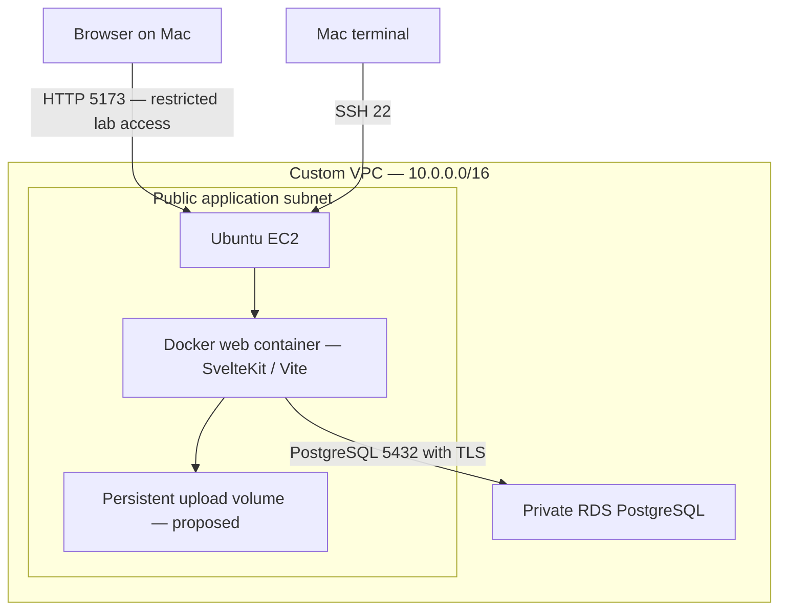

# myProperty — AWS EC2 and RDS Lab

A hands-on cloud engineering portfolio project: run a containerized property-management application on Amazon EC2 and connect it to private Amazon RDS PostgreSQL.

This document records the lab's setup, deployment workflow, troubleshooting, and remaining work as of **19 October 2026**. It is based on reviewed source and reported results, not a fresh audit of the running AWS account. Use test data only; this is not a production-ready service.

The application is an existing open-source project adapted for an AWS lab. Preserve its original `LICENSE`, attribution, and application documentation. Infrastructure and deployment changes should be distinguished from upstream application development.

## 1. Current status

| Item | Status / evidence |
|---|---|
| Default and custom VPC diagrams | Created during the networking exercise |
| Subnet communication | ICMP connectivity tested |
| Terraform VPC/EC2 | EC2 provisioned and SSH access established |
| RDS PostgreSQL | Created manually; not confirmed managed by Terraform |
| EC2-to-RDS networking | PostgreSQL connection reached the server after troubleshooting |
| Web container | HTTP 200 and HTML returned on EC2 port 5173 |
| Public-IP access | Reported working |
| Public-DNS access | DNS reached Vite, which rejected the hostname; public IP used instead |
| Property workflow | Reported working after troubleshooting |
| Unit creation | Stalled during property lookup; query-runner fix proposed, successful retest not yet confirmed |
| Upload/download workflow | Storage changes advised; end-to-end verification outstanding |
| HTTPS / ALB | Not deployed in this stage |
| CI/CD / monitoring | Planned, not completed |

A successful homepage response does not prove that every API, database operation, or authorization check works.

## 2. Architecture



An alternative browser path uses an SSH tunnel and binds Docker's published port to EC2 loopback only.

- Region: `ap-southeast-7` (Thailand).
- App: SvelteKit, TypeScript, Vite, Node.js, TypeORM, PostgreSQL.
- Current hosting approach: public EC2 with a Docker web container, private RDS, no ALB.
- No NAT is required for private EC2-to-RDS communication within the VPC.
- Browser-to-app HTTP and app-to-RDS TLS are separate connections. Enabling database TLS does not enable website HTTPS.

### Intended subnet layout

| AZ | Public | Private |
|---|---|---|
| ap-southeast-7a | 10.0.1.0/24 | 10.0.2.0/24 |
| ap-southeast-7b | 10.0.4.0/24 | 10.0.3.0/24 |

The second public subnet was included in the improved Terraform baseline; verify the applied state. Because RDS was created manually, inspect its actual VPC, DB subnet group, and `Publicly accessible` setting. Do not assume it matches the intended layout. During troubleshooting its endpoint resolved into `10.0.1.0/24`; a private IP alone does not prove placement in a private subnet.

### Security-group rules

| Destination | Port | Source |
|---|---|---|
| EC2 SSH | TCP 22 | Administrator public IPv4 /32 |
| EC2 lab web, direct access only | TCP 5173 | Administrator public IPv4 /32 |
| RDS | TCP 5432 | Security-group ID attached to app EC2 |

Broad outbound EC2 access was used for the lab. Opening 443 alone does not install TLS. An open-to-all SSH rule was discussed temporarily; verify that access is restricted again.

## 3. Project files and working locations

Application paths are relative to the repository root:

| Path | Purpose |
|---|---|
| `code/docker-compose.yml` | Start the web container |
| `code/Dockerfile` | Build its image |
| `code/.dockerignore` | Keep secrets and Mac dependencies out of the image |
| `code/.env` | EC2-specific configuration; never commit |
| `code/certs/global-bundle.pem` | Public AWS RDS CA certificate bundle |
| `code/src/lib/server/database/database.ts` | TypeORM connection and TLS settings |
| `code/src/hooks.server.ts` | Database initialization and reference-data seeding |
| `code/src/routes/api/unit/+server.ts` | Unit-creation endpoint |
| `code/src/lib/server/services/documentService.ts` | Document storage |
| `code/src/middleware/apiResponse.ts` | API error responses |

Terraform may live in a separate `vpc-ec2-rds` directory. Its generated baseline splits configuration into `versions.tf`, `providers.tf`, `networking.tf`, `security.tf`, `compute.tf`, `variables.tf`, and `outputs.tf`. Confirm the actual repository layout before copying files.

**Mac terminal:** edit code, Git commit/push, Terraform, browser diagnostics.

**EC2 terminal (`ubuntu@...`):** Git pull, Docker commands, RDS connectivity tests.

Running `docker compose logs` on the Mac displays local containers, not AWS logs.

## 4. Terraform and AWS authentication

Run in the existing Terraform directory with its state/backend:

```bash
aws configure list-profiles
export AWS_PROFILE=YOUR_LAB_PROFILE
aws sts get-caller-identity
terraform init
terraform fmt
terraform validate
terraform plan
```

Verify the account ID before applying. The improved provider configuration uses `allowed_account_ids`. Authenticate using the method configured for your profile if the identity check fails. Do not put access keys in `.tf` files.

Keep the existing state, workspace, backend, and `.terraform.lock.hcl`. The generated baseline selected AWS provider 5.x alongside VPC module 5.19.0; do not blindly downgrade an existing provider/state that already uses 6.x.

RDS add-on Terraform files were supplied, but the active database was created manually. Applying those files can create a second database. Import the existing RDS resources carefully or continue managing them manually until a deliberate migration is planned.

## 5. SSH into EC2

On the Mac:

```bash
chmod 400 ~/.ssh/YOUR_KEY.pem
ssh -i ~/.ssh/YOUR_KEY.pem ubuntu@YOUR_EC2_PUBLIC_IP
```

The `.pem` must match the instance's key pair. `key_name` in Terraform references a key pair; it does not itself generate/download the private key. Ubuntu has no default login password for this SSH workflow.

The observed instance banner showed Ubuntu 26.04, while the initial AMI example targeted Ubuntu 24.04. Check the deployed instance rather than assuming:

```bash
cat /etc/os-release
```

Pin the existing verified AMI ID when updating Terraform if replacement is not intended.

## 6. Git workflow

### Mac: publish a change

```bash
git status
git remote -v
git branch --show-current
# Switch only if this branch already exists:
git switch aws-deployment
git diff
# Stage only the intended files, then inspect:
git add PATH_TO_CHANGED_FILE
git diff --cached
git commit -m "Describe the deployment change"
git push origin aws-deployment
```

For the first creation of that branch use `git switch -c aws-deployment` instead. Verify the remote belongs to your repository, not an upstream/client repository.

### EC2: retrieve a change

```bash
cd ~/myProperty
git pull --ff-only origin aws-deployment
cd code
docker compose up -d --build --force-recreate web
```

For a private repository use appropriately scoped GitHub authentication, such as a read-only deploy key. HTTPS authentication uses a token rather than the GitHub account password. Never embed tokens in URLs or commit them.

### If EC2 Compose edits block a pull

```bash
cd ~/myProperty
git diff -- code/docker-compose.yml
git stash push -m "EC2 compose settings" -- code/docker-compose.yml
git pull --ff-only origin aws-deployment
git stash pop
```

If there is a conflict, resolve it before starting the container. Do not discard the stash or use `git reset --hard` blindly. Long term, keep deployment configuration in Git and avoid undocumented edits on EC2.

## 7. RDS database setup

### Identify the correct names

These are different values:

- RDS instance identifier: the AWS resource name.
- RDS endpoint: the hostname used as `DATABASE_HOST`.
- PostgreSQL database name: e.g. `propertyapp`.
- Master username: the login selected when RDS was created.
- Website user: an account stored inside the application tables.

Copy the endpoint and master username from the RDS console. Do not assume the instance identifier is also a database name.

### Install client and certificate on EC2

```bash
sudo apt-get update
sudo apt-get install -y postgresql-client curl
mkdir -p ~/rds-certs
curl -fsSL https://truststore.pki.rds.amazonaws.com/global/global-bundle.pem \
  -o ~/rds-certs/global-bundle.pem
```

### Connect to the default database

```bash
psql "host=YOUR_RDS_ENDPOINT port=5432 dbname=postgres user=YOUR_MASTER_USERNAME sslmode=verify-full sslrootcert=$HOME/rds-certs/global-bundle.pem connect_timeout=10" -W
```

The password prompt is normal and does not prove a connection has succeeded. Input is hidden. Use the actual password from creation or the managed secret, if enabled.

Inside psql, inspect before creating anything:

```sql
\l
```

For a new database only:

```sql
CREATE DATABASE propertyapp;
\connect propertyapp
CREATE ROLE propertyapp_user LOGIN;
\password propertyapp_user
GRANT CONNECT ON DATABASE propertyapp TO propertyapp_user;
GRANT USAGE, CREATE ON SCHEMA public TO propertyapp_user;
```

These grants support initial schema creation in an empty lab database. Existing tables owned by another role may require ownership/privilege adjustments. Do not recreate roles/databases that already exist. Use a dedicated application user rather than the master account for normal operation.

## 8. Application environment and database TLS

Create `code/.env` directly on EC2. This is a template; replace all placeholders:

```dotenv
DATABASE_HOST=YOUR_RDS_ENDPOINT
DATABASE_PORT=5432
DATABASE_NAME=propertyapp
DATABASE_USER=propertyapp_user
DATABASE_PASSWORD='REPLACE_WITH_APP_PASSWORD'
DATABASE_SSL=true
DATABASE_CA_PATH=/app/certs/global-bundle.pem
DATABASE_SYNCHRONIZE=false
DATABASE_LOGGING=false
JWT_SECRET=REPLACE_WITH_RANDOM_SECRET
JWT_EXPIRATION_TIME=1h
```

Generate a JWT secret with `openssl rand -hex 32`. Protect the file:

```bash
chmod 600 .env
```

The SSL/synchronization variables require the updated `database.ts` code to read them; adding variables alone does not change TypeORM behavior. TLS should use the CA bundle with `rejectUnauthorized: true`.

Download the public certificate into `code/certs/` before building so it is present inside the image:

```bash
mkdir -p certs
curl -fsSL https://truststore.pki.rds.amazonaws.com/global/global-bundle.pem \
  -o certs/global-bundle.pem
```

For the first startup against a disposable empty lab database, explicitly set `DATABASE_SYNCHRONIZE=true`. After verifying table creation, set it back to false and recreate the container. Do not enable automatic synchronization against valuable data as a substitute for migrations.

The original source has `migrations: []`; its migration scripts require repair and verification. Startup seeds reference roles/statuses/document types, not a default administrator account.

## 9. Docker configuration and start-up

Use Docker Engine and the Compose plugin on EC2. A convenience installer run with `--dry-run` only prints commands. Verify actual installation:

```bash
docker --version
docker compose version
sudo docker run --rm hello-world
```

If using the Docker group, remember it grants root-equivalent control:

```bash
sudo usermod -aG docker ubuntu
newgrp docker
```

The lab Dockerfile should use a supported Node version, copy both package manifests, run `npm ci`, and exclude Mac `node_modules` and `.env` via `.dockerignore`. The initial source used Node 18 and `npm install`; a Node 22 image was proposed. Confirm the deployed image before claiming that upgrade is complete.

Recommended restricted lab Compose structure:

```yaml
services:
  web:
    build: .
    restart: unless-stopped
    ports:
      - "127.0.0.1:5173:5173"
    env_file:
      - .env
    volumes:
      - uploads_data:/app/uploads
    command:
      - sh
      - -c
      - npx svelte-kit sync && npm run dev -- --host 0.0.0.0

volumes:
  uploads_data:
```

Remove the old `depends_on: db` if the local database service is removed. RDS is external to Compose. The top-level Compose `version` field is obsolete.

```bash
cd ~/myProperty/code
docker compose up -d --build
docker compose ps
docker compose logs --since=5m --tail=100 web
curl -I http://localhost:5173
```

An environment-file change needs container recreation, not just `restart`:

```bash
docker compose up -d --force-recreate web
```

Source copied into the image needs a rebuild. A bind mount changes that behavior; inspect the actual Compose file. Avoid posting `docker compose config` output unredacted because it can expose environment secrets.

## 10. Browser access

### Option A: SSH tunnel

Keep the loopback port mapping above. On the Mac:

```bash
ssh -i ~/.ssh/YOUR_KEY.pem -N -o ExitOnForwardFailure=yes \
  -L 127.0.0.1:5174:127.0.0.1:5173 ubuntu@YOUR_EC2_PUBLIC_IP
```

Open `http://localhost:5174`. Port 5174 avoids a collision with a local development server on 5173. The SSH terminal remaining blank is normal.

### Option B: direct public-IP access

Change the mapping to `"5173:5173"`, recreate the container, and allow TCP 5173 from your public IP /32 in the EC2 SG. Open `http://YOUR_EC2_PUBLIC_IP:5173`.

### Public DNS

Use the EC2 **Public IPv4 DNS**, HTTP, and port 5173. If Vite reports a blocked host, add the exact hostname under `server.allowedHosts` in the existing Vite configuration. Do not set `allowedHosts: true` broadly. Rebuild if the configuration is copied into the image.

### Relative frontend URLs

Replace `http://localhost:5173/api/...` with `/api/...` in browser requests. Hardcoded localhost points at the visitor's machine. Ten frontend files in the reviewed snapshot contained the old origin. Verify all relevant replacements in the current code.

## 11. Website accounts and database inspection

The reviewed role enum contains `owner`, `tenant`, `maintenance manager`, and `maintenance operator`. There is no separate admin role or seeded default admin login. The owner role is the closest property-management role.

Registration is at `/register`. Check the actual form and API behavior; public privileged-role selection is a known issue and must be fixed before public use.

Useful psql commands:

```sql
SELECT current_database(), current_user;
\dt public.*
\d public.property
SELECT * FROM public.property LIMIT 20;
SELECT COUNT(*) FROM public.property;
SELECT * FROM public.unit LIMIT 20;
```

Creating a property/unit inserts a row, not a new table.

Inspect website users without selecting password hashes, after verifying table/column names:

```sql
SELECT u.id, u.username, r.name AS role
FROM public."user" u
LEFT JOIN public."role" r ON r.id = u."roleId";
```

`\du` lists PostgreSQL roles, not website accounts.

## 12. Troubleshooting reference

| Symptom | Diagnosis / next action |
|---|---|
| Terraform has no valid credentials; IMDS lookup fails | Select the lab AWS profile on the Mac and verify `aws sts get-caller-identity` |
| Undeclared SG/VPC resource | Match real Terraform addresses; module VPC ID is `module.vpc.vpc_id` |
| Undeclared input variable | Declare it in a `.tf` file; assign its value in `.tfvars` |
| `/32` validation fails | SSH admin CIDR needs a valid IPv4 /32; HTTPS has its own rule |
| Git pull would overwrite Compose | Preserve local edits with a scoped stash, pull, restore and resolve conflicts |
| Missing `.svelte-kit/tsconfig.json` | Run `svelte-kit sync` before starting Vite |
| Database timeout | Check current endpoint, SG source, VPC, routing, and host vs container reachability |
| Database does not exist | Connect to `postgres`, list databases, use/create the application DB |
| Internal Error from web | Inspect EC2 container logs, not Mac Docker logs |
| Public IP works; hostname blocked | Add exact DNS hostname to Vite allowed hosts |
| HTTP works but HTTPS fails | No TLS server/certificate is configured; opening 443 is insufficient |
| SSH tunnel address already in use | Choose another Mac-side port such as 5174 |
| Empty recent Docker logs | No messages in that interval; check HTTP and actual API requests |
| Add Unit stalls | Inspect request and connection lifecycle; see below |

### Network tests on EC2

```bash
nc -vz -w 5 YOUR_RDS_ENDPOINT 5432
ls -l ~/rds-certs/global-bundle.pem
```

Check container configuration without printing credentials:

```bash
docker compose exec web node -e 'console.log({host:process.env.DATABASE_HOST,database:process.env.DATABASE_NAME,user:process.env.DATABASE_USER})'
```

If EC2 reaches RDS but the container does not, inspect container configuration, routing and host firewall. Do not disable TLS or change passwords to fix a network timeout.

### Unit creation investigation — unresolved verification

The request reached `/api/unit`; logs showed property lookup starts without matching results. The reviewed routes construct query runners at module scope and do not release them. This can exhaust the connection pool. Pool exhaustion is a strong suspect, not proven from these logs alone; database locks or other waits remain possible.

A patch was supplied for `code/src/routes/api/unit/+server.ts` to:

1. Create one query runner per request.
2. Share it between property and unit repositories.
3. Connect inside a try block.
4. Release in finally, including failed requests.

The first deployment attempt was blocked by local Compose edits. Successful deployment and retesting were not confirmed at this documentation checkpoint.

After deploying, refresh the browser and submit once. In DevTools inspect `/api/unit` status, payload and response. If no request appears, inspect the Console. If pending, inspect server logs and PostgreSQL activity/locks. Check whether a row was inserted before retrying to avoid duplicates. Review every other route for the same connection lifecycle problem; a single-route fix does not repair the whole application.

## 13. Known application issues and proposed fixes

| Finding in reviewed source | Required action / verification |
|---|---|
| API errors returned JSON status but HTTP 200 | Use `json({ error: message, status }, { status })` |
| Login request body logged | Remove password/request-body logging |
| Registration accepts caller-selected role | Restrict privileged account creation server-side |
| User listing lacks authorization and safe projection | Require authorization; omit password hashes and unnecessary personal data |
| Document APIs lack consistent ownership checks | Verify token and authorization for each document |
| Upload directory not created | `fs.mkdir(uploadsDir, { recursive: true })` before writing |
| Full upload path stored, then upload directory prepended | Store a filename/storage key consistently; migrate or re-upload old records |
| `uuid` imported without direct dependency | Use Node `randomUUID()` or explicitly declare dependency |
| Frontend expects `/uploads/...` without matching route | Implement an authenticated download endpoint |
| Runtime uploads may disappear with container replacement | Use a persistent volume and a separate backup plan |
| Development server used for deployment | Adopt a compatible Node adapter and tested production build later |

These findings are not a claim that all fixes have been applied. Keep the lab IP-restricted and use dummy data until authorization is verified. Any credentials exposed in source, logs or troubleshooting should be rotated; deleting text alone does not revoke them.

## 14. Validation checklist

- [ ] Correct AWS account, region, AMI, and Terraform state confirmed.
- [ ] RDS actual subnet placement and public-access setting verified.
- [ ] App uses the intended database and a dedicated user.
- [ ] TLS certificate verification succeeds from inside the container.
- [ ] Homepage responds and login/registration behave correctly.
- [ ] Property creation/listing verified against database rows.
- [ ] Unit fix deployed and repeated creation/listing tested.
- [ ] API errors use correct HTTP statuses.
- [ ] Upload/download authorization and persistence tested.
- [ ] Credentials and tokens absent from logs/Git/image layers.
- [ ] Synchronization disabled after initial schema bootstrap.
- [ ] Container recreation preserves database data and upload files.

## 15. Next milestones

1. Finish application functionality and connection lifecycle fixes.
2. Build/run SvelteKit in production mode rather than Vite development mode.
3. Add HTTPS with a domain and reverse proxy on EC2; no ALB is required for this step.
4. Bring the manually created database under deliberate Terraform management.
5. Add logs, health checks, alarms, backups and a tested restore procedure.
6. Add GitHub Actions deployment using short-lived AWS credentials.
7. Later introduce ALB, private app compute, and multi-AZ availability testing.
8. Move documents to private object storage if scaling beyond one EC2 host.

## 16. Cleanup and cost control

Review EC2, EBS, public IPv4, RDS, snapshots, secrets and logs for ongoing charges. Do not assume free-tier eligibility. Stopping resources does not remove every charge.

`terraform destroy` only removes resources tracked by that state. The manually created RDS database must be handled separately. Preserve needed data, understand deletion protection/final-snapshot settings, and retain Terraform state until cleanup is complete. RDS snapshots and retained volumes may remain billable after compute deletion.

Do not run `docker compose down -v` unless upload-volume deletion is intended.

## 17. Publishing this document

To preserve upstream documentation, save this as `docs/AWS-LAB.md` and link it from the existing root README. Alternatively merge the relevant sections into the root README without removing license attribution.

```bash
# After saving the file in your local repository:
git add docs/AWS-LAB.md
git diff --cached
git commit -m "Document AWS lab deployment and troubleshooting"
git push origin aws-deployment
```

Exclude `.env`, private keys, Terraform state/plan files and credentials. Commit the Terraform dependency lock file and sanitized examples. Public CA certificates are not secrets.

### Reference documentation

- RDS PostgreSQL TLS: https://docs.aws.amazon.com/AmazonRDS/latest/UserGuide/PostgreSQL.Concepts.General.SSL.html
- TypeORM query runner lifecycle: https://typeorm.io/docs/query-runner/
- Terraform S3 backend: https://developer.hashicorp.com/terraform/language/backend/s3
- Docker on Ubuntu: https://docs.docker.com/engine/install/ubuntu/

Update this document after each successful milestone; record observed results separately from proposed changes.
