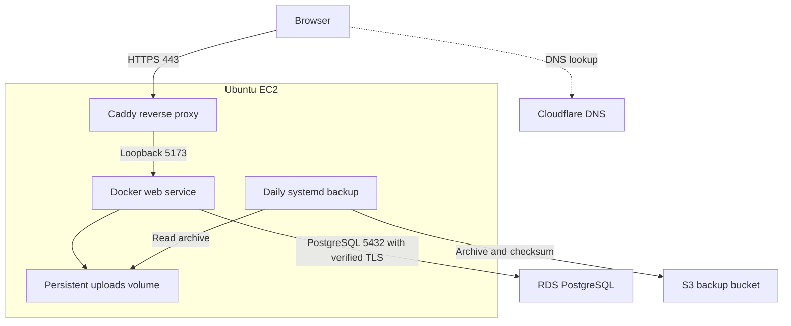
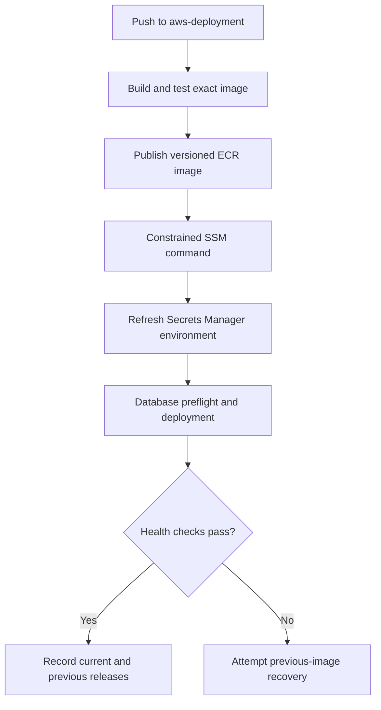

Application: [TeceroTech Property](https://github.com/SilvaRohit/myProperty/tree/aws-deployment)

# TeceroTech-Property — Application and Operations Guide

A cloud engineering portfolio project that takes an existing property-management application from local Docker testing to an AWS deployment with repeatable releases, rollback, recovery exercises, and monitoring.

The application is adapted from the existing **myProperty** codebase. The portfolio contribution covers AWS infrastructure, deployment automation, operational improvements, and selected application fixes. Preserve the original attribution and [LICENSE](LICENSE), which contains the GNU Affero General Public License v3.

**Documented:** 23 October 2026  
**Application branch:** `aws-deployment`  
**Source reviewed:** `7d3cd41ad1f2ef5039aeb3b685fbf852707e3c1d`  
**Application repository:** [SilvaRohit/myProperty](https://github.com/SilvaRohit/myProperty/tree/aws-deployment)  
**Infrastructure repository:** [SilvaRohit/myProperty-infra](https://github.com/SilvaRohit/myProperty-infra)

Place this guide at the **application repository root as `README.md`**. Commands marked **Mac**, **EC2**, or **PostgreSQL** run in those environments. Replace `YOUR_...` and `REPLACE_...` values before use.

## Contents

- [1. Outcome and scope](#1-outcome-and-scope)
- [2. Architecture](#2-architecture)
- [3. Repositories and files](#3-repositories-and-files)
- [4. The lab from start to finish](#4-the-lab-from-start-to-finish)
- [5. Local development](#5-local-development)
- [6. Database configuration and accounts](#6-database-configuration-and-accounts)
- [7. EC2 setup and HTTPS](#7-ec2-setup-and-https)
- [8. Installed deployment runtime](#8-installed-deployment-runtime)
- [9. GitHub Actions](#9-github-actions)
- [10. Daily deployment](#10-daily-deployment)
- [11. Rollback and roll forward](#11-rollback-and-roll-forward)
- [12. Secrets Manager](#12-secrets-manager)
- [13. Upload backups and recovery](#13-upload-backups-and-recovery)
- [14. Monitoring and logs](#14-monitoring-and-logs)
- [15. Troubleshooting](#15-troubleshooting)
- [16. Limitations and deferred work](#16-limitations-and-deferred-work)
- [17. Evidence and references](#17-evidence-and-references)

## 1. Outcome and scope

| Area | Implemented outcome |
|---|---|
| Hosting | One Ubuntu EC2 instance running a Docker Compose web service |
| Website | `https://property.tecerotech.com` through Caddy, with Cloudflare DNS |
| Database | Private-access RDS PostgreSQL, reached over verified TLS |
| Image delivery | GitHub Actions builds/tests an image and publishes a versioned ECR tag |
| Deployment | GitHub OIDC credentials and a constrained Systems Manager command |
| Rollback | GitHub Actions button restores the previously recorded image |
| Configuration | Secrets Manager environment retrieval before deployments |
| Upload persistence | Existing `code_uploads_data` volume mounted at `/app/uploads` |
| Upload backups | Daily archives and SHA-256 checksums in a private, versioned S3 bucket |
| Database recovery | Point-in-time restore tested with a separate temporary RDS instance |
| Monitoring | Disk/memory metrics, EC2/RDS alarms, SNS email, combined dashboard |
| Application logs | Docker `awslogs` forwarding with seven-day CloudWatch retention |
| Infrastructure | Separate Terraform repository and HCP Terraform remote state/execution |

This is a **single-instance learning environment**, not a production-readiness claim. The application still runs the Vite development server. ALB, autoscaling, Multi-AZ database failover, and an independently scheduled HTTPS availability check were not implemented.

Existing website HTTPS is enabled. Deployment and rollback workflows perform an HTTPS check **when they run**; that is different from continuous availability monitoring. The lab was intentionally concluded without a scheduled HTTPS monitor.

## 2. Architecture



Caddy terminates website TLS and proxies to `127.0.0.1:5173`. Database TLS is a separate connection.

RDS has `PubliclyAccessible=false` and a dedicated security group accepting TCP 5432 from the EC2 application security group. Its retained subnet group contains the original mixed public/private subnet inventory. It was not migrated to a private-subnet-only group.

### Release flow



The workflow does not use an SSH private key. EC2 obtains AWS permissions through its instance role; GitHub uses temporary OIDC credentials.

## 3. Repositories and Files

| Repository | Branch | Responsibility |
|---|---|---|
| `myProperty` | `aws-deployment` | Application, images, deploy/backup scripts, agent configuration, workflows |
| `myProperty-infra` | `main` | AWS resources, IAM, imports, state configuration, backups, secret metadata, monitoring |

The npm package remains `my-property`; visible project branding is **TeceroTech-Property**. Package, repository, image repository, and website names can differ.

| Application path | Purpose |
|---|---|
| `code/package.json` / `package-lock.json` | Scripts, dependencies, reproducible `npm ci` |
| `code/Dockerfile.ci` | Node 22 image used by the AWS build workflow |
| `code/Dockerfile` | Separate local/manual image definition |
| `code/svelte.config.js` | Currently `adapter-auto` |
| `code/vite.config.ts` | Allowed host, development server, HTTPS HMR, tests |
| `code/src/hooks.server.ts` | TypeORM initialization and reference-data seeds |
| `code/src/lib/server/database/database.ts` | Database settings and TLS |
| `code/src/routes/api/unit/+server.ts` | Request-scoped query-runner fix |
| `code/src/routes/api/tenant/me/+server.ts` | Tenant rental/maintenance API and assignment checks |
| `code/src/middleware/apiResponse.ts` | HTTP error responses and sanitized failure logs |
| `code/docker-compose.yml` | Earlier deployment file pinned to an old ECR image |
| `code/docker-compose-db-only.yaml` | Historical local DB file; inspect PostgreSQL version/storage before reuse |
| `deploy/compose.yml` | Git-managed deployment Compose template |
| `deploy/bootstrap-ec2.sh` | Adopts an already running service |
| `deploy/deploy.sh` | Repository deployment implementation |
| `deploy/check-db.mjs` | Verified-TLS PostgreSQL `SELECT 1` preflight |
| `deploy/request-deploy.py` | Input validation, SSM submission and polling |
| `deploy/refresh-env.sh` | Active secret retrieval and environment replacement |
| `deploy/backup-uploads.sh` | Upload-volume archive and checksum |
| `deploy/systemd/` | Backup service and timer |
| `deploy/cloudwatch-agent.json` | Root-disk and memory collection |
| `.github/workflows/build-ecr.yml` | Build/test/publish/deploy |
| `.github/workflows/rollback.yml` | Manual rollback |

### Working locations

| Environment | Location |
|---|---|
| Mac application checkout used in the lab | `~/Desktop/pov-labs/myProperty-aws` |
| EC2 checkout | `/home/ubuntu/myProperty` |
| EC2 environment | `/home/ubuntu/myProperty/code/.env` |
| RDS CA certificate | `/home/ubuntu/myProperty/code/certs/global-bundle.pem` |
| Active deployment runtime | `/opt/property-app-deploy` |
| Compose project / container | `code` / `code-web-1` |
| Existing upload volume | `code_uploads_data` |

The **Git checkout, installed runtime, and running image are separate**. A Git pull does not itself install scripts or replace a container.

## 4. The lab from start to finish

1. **Networking:** draw default/custom VPCs, understand AZs/subnets/routes/IGW/SGs/ENIs/NACLs, and test ICMP.
2. **Terraform:** replace manually created VPC/EC2 resources with a versioned baseline.
3. **Application hosting:** run Docker on EC2 and connect to a manually created RDS PostgreSQL instance.
4. **Connectivity:** fix container-local `localhost` settings, the SQL database name, TLS configuration, browser origins, and allowed hosts.
5. **HTTPS:** associate an Elastic IP, configure Cloudflare DNS, and run Caddy in front of the loopback web port.
6. **Selected app fixes:** address unit creation, tenant assignments, maintenance visibility, document paths, API status codes, and selected authorization checks.
7. **Adoption:** import the existing RDS/subnet group and Elastic IP/association into Terraform.
8. **CI/CD:** build/test versioned images, publish to ECR, deploy through OIDC/SSM, and add rollback.
9. **HCP Terraform:** migrate state, connect the infrastructure repository, and use separate remote plan/apply identities.
10. **Recovery:** extend RDS retention, test PITR, schedule S3 upload backups, and recover a sample file.
11. **Configuration/capacity:** retrieve secrets at deployment and expand the root volume after image downloads exhausted it.
12. **Monitoring:** implement metrics, alarms, email, dashboard, credential-log cleanup, and centralized application logs.

Selected browser workflows were tested; this was not complete product QA.

## 5. Local development

### Prerequisites and clone

Use Git, Docker Desktop/Compose, and disposable PostgreSQL data. Host-run development also needs Node 22/npm.

```bash
git clone --branch aws-deployment \
  https://github.com/SilvaRohit/myProperty.git myProperty-aws
cd myProperty-aws/code
```

The existing `code/docker-compose.yml` references an old AWS image. Use an isolated local Compose definition instead of treating it as the current release.

### Fresh disposable Docker example

Create `code/compose.local.yml` using this reference example; this file is not already supplied:

```yaml
services:
  db:
    image: postgres:18
    environment:
      POSTGRES_USER: ${DATABASE_USER}
      POSTGRES_PASSWORD: ${DATABASE_PASSWORD}
      POSTGRES_DB: ${DATABASE_NAME}
    volumes:
      - local_pg18_data:/var/lib/postgresql
    healthcheck:
      test: ["CMD-SHELL", "pg_isready -U $$POSTGRES_USER -d $$POSTGRES_DB"]
      interval: 5s
      timeout: 5s
      retries: 10

  web:
    build:
      context: .
      dockerfile: Dockerfile.ci
    depends_on:
      db:
        condition: service_healthy
    ports:
      - "127.0.0.1:5173:5173"
    env_file:
      - .env.local-docker
    volumes:
      - local_uploads_data:/app/uploads

volumes:
  local_pg18_data:
  local_uploads_data:
```

PostgreSQL 18 uses a different default volume layout from 17 and earlier. This example uses `/var/lib/postgresql` and a new volume. Do not attach an old data volume to a different major version and assume it is an upgrade.

Create ignored `code/.env.local-docker`:

```dotenv
DATABASE_HOST=db
DATABASE_PORT=5432
DATABASE_NAME=propertyapp
DATABASE_USER=propertyapp
DATABASE_PASSWORD=REPLACE_WITH_LOCAL_TEST_PASSWORD
DATABASE_SSL=false
DATABASE_SYNCHRONIZE=true
DATABASE_LOGGING=false
JWT_SECRET=REPLACE_WITH_RANDOM_LOCAL_SECRET
JWT_EXPIRATION_TIME=1h
```

Generate a secret with `openssl rand -hex 32`. Synchronization here creates the initial schema in a disposable local DB.

```bash
docker compose --project-name property-local \
  --env-file .env.local-docker \
  --file compose.local.yml up -d --build
```

Open `http://localhost:5173`. This example copies source into the image, so rebuild after changes.

The current Vite HMR settings point to `property.tecerotech.com`. Local hot reload needs a separate/conditional HMR setting. Preserve the AWS configuration.

For a host-run Node process connecting to a published local DB port, `DATABASE_HOST` would be `localhost`. For the web container above, it is `db`: container `localhost` means that container.

### Tests

From `code/`:

```bash
npm ci
npm run coverage
```

The pipeline runs coverage inside the exact image it publishes. JWT tests generate fresh signed tokens; expired-token and wrong-secret cases remain negative tests.

Many repository tests use mocks. Passing tests do not prove RDS connectivity or every UI workflow.

## 6. Database configuration and accounts

| Value | Meaning |
|---|---|
| RDS identifier | `property-app-db` |
| SQL database | `propertyapp` |
| Host | Full RDS `*.rds.amazonaws.com` endpoint |
| PostgreSQL login | Actual SQL role; the lab retained `postgres` |
| Website user | Record in the application `user` table |
| Website roles | `owner`, `tenant`, `maintenance manager`, `maintenance operator` |

There is no verified universal `admin/admin` login. Startup seeds reference roles/statuses/document types, not a guaranteed admin account. Use actual test accounts; privileged registration still requires a broader review.

### AWS dotenv template

The Secrets Manager value is a **plaintext dotenv document**, not a JSON map:

```dotenv
DATABASE_HOST=YOUR_RDS_ENDPOINT
DATABASE_PORT=5432
DATABASE_NAME=propertyapp
DATABASE_USER=YOUR_DATABASE_USERNAME
DATABASE_PASSWORD=REPLACE_WITH_DATABASE_PASSWORD

DATABASE_SSL=true
DATABASE_CA_PATH=/app/certs/global-bundle.pem
DATABASE_SYNCHRONIZE=REPLACE_WITH_INTENDED_TRUE_OR_FALSE
DATABASE_LOGGING=false

JWT_SECRET=REPLACE_WITH_RANDOM_SECRET
JWT_EXPIRATION_TIME=1h
```

The code reads these settings explicitly. TLS uses the CA bundle and `rejectUnauthorized: true`. Fix missing certificates/paths rather than disabling verification.

Synchronization was used during setup. The code still has `migrations: []`; a verified migration-based release process was not implemented. The live synchronization setting is protected configuration and was not inspected for this document.

### PostgreSQL inspection on EC2

```bash
sudo apt-get update
sudo apt-get install -y postgresql-client curl
mkdir -p ~/rds-certs
curl -fsSL \
  https://truststore.pki.rds.amazonaws.com/global/global-bundle.pem \
  -o ~/rds-certs/global-bundle.pem

psql "host=YOUR_RDS_ENDPOINT port=5432 dbname=propertyapp user=YOUR_DATABASE_USERNAME sslmode=verify-full sslrootcert=$HOME/rds-certs/global-bundle.pem connect_timeout=10" -W
```

If the database does not exist, connect to `postgres`, inspect `\l`, and create the intended DB only when appropriate.

```sql
SELECT current_database(), current_user;
\dt public.*
\d public.property
SELECT COUNT(*) AS property_count FROM public.property;
SELECT COUNT(*) AS unit_count FROM public.unit;

SELECT u.id, u.username, r.name AS role
FROM public."user" u
LEFT JOIN public."role" r ON r.id = u."roleId";
```

Adding a property/unit inserts a row, not a new table. `\du` shows PostgreSQL roles, not website users.

## 7. EC2 setup and HTTPS

Terraform does not currently recreate every host configuration and populate the application in one operation.

### SSH from the Mac

```bash
chmod 400 ~/.ssh/YOUR_KEY.pem
ssh -i ~/.ssh/YOUR_KEY.pem ubuntu@YOUR_EC2_ELASTIC_IP
```

The Terraform baseline references an existing key pair. Its name is not the private key file, and the private key cannot be assumed downloadable later.

SSH TCP 22 was intentionally left open to `0.0.0.0/0`. This guide records that lab choice.

### Host prerequisites

Install Docker Engine and Compose using Docker's Ubuntu instructions. Verify on EC2:

```bash
sudo docker version
sudo docker compose version
aws --version
```

An installer invoked with `--dry-run` prints commands without installing Docker. The supplied scripts also use `curl`, `flock`, `python3`, `tar`, and `sha256sum`. AWS access comes from the instance role.

```bash
git clone --branch aws-deployment \
  https://github.com/SilvaRohit/myProperty.git ~/myProperty
mkdir -p ~/myProperty/code/certs
curl -fsSL \
  https://truststore.pki.rds.amazonaws.com/global/global-bundle.pem \
  -o ~/myProperty/code/certs/global-bundle.pem
```

Create the initial protected `code/.env` using the correct configuration. Prepare the SQL database/schema separately. Never commit the real environment file.

### Caddy and Cloudflare

The website uses an Elastic IP, a Cloudflare DNS record, EC2 ingress 80/443, and Caddy forwarding to loopback 5173.

Minimal reference Caddyfile:

```caddyfile
property.tecerotech.com {
    reverse_proxy 127.0.0.1:5173
}
```

Inspect the actual host configuration before replacing it. Certificate issuance and Cloudflare TLS settings must match the certificate arrangement. For a proxied record, use verified origin HTTPS rather than Flexible mode.

```bash
sudo caddy validate --config /etc/caddy/Caddyfile
sudo systemctl reload caddy
```

Port 443 alone does not install TLS. The Vite allowed host is `property.tecerotech.com`; do not broadly set `allowedHosts: true`.

## 8. Installed deployment runtime

| File under `/opt/property-app-deploy` | Meaning |
|---|---|
| `compose.yml` | Compose definition actually used |
| `deploy.sh` | Installed script; may differ from the Git copy |
| `check-db.mjs` | DB preflight |
| `refresh-env.sh` | Secret retrieval |
| `release.env` | Current `APP_IMAGE` and `UPLOADS_VOLUME` only |
| `previous.env` | Previous successful release |
| `project-name` | Existing Compose project |
| `highest-run-id` | Rejects accidental older workflow deployments |
| `rollback-requests/` | Idempotency records installed by the rollback runtime |
| `backup-uploads.sh` | Installed backup job |
| `env.before-secrets` | Protected initial environment backup, outside Git |

Releases, refreshes, and backups share `deploy.lock`. Secret refresh completes before the deployment script takes its own lock.

### First adoption

`deploy/bootstrap-ec2.sh` adopts an **already running healthy** Compose `web` service. It discovers project, image, and volume. It does not install Docker/Caddy or start the first application.

For a fresh disposable rebuild:

1. Prepare infrastructure, RDS/database/schema, IAM, certificates, environment, and host software.
2. Build `code/Dockerfile.ci` or select a known ECR image.
3. Start one Compose `web` service using project `code`, loopback 5173, the protected environment, CA mount, and volume `code_uploads_data`.
4. Verify `curl -I http://127.0.0.1:5173/` succeeds.
5. Adopt it with the command below.
6. Establish at least two successful versioned ECR releases before relying on previous-image rollback.

Do not mistake the old image pinned in `code/docker-compose.yml` for the current application.

For a new host with the database/schema and protected `code/.env` already prepared, this first-start reference can create the service that bootstrap adopts. Run from `~/myProperty` on EC2:

```bash
sudo docker build --file code/Dockerfile.ci \
  --tag property-app-bootstrap:local code

cat > /var/tmp/property-first-start.yml <<'YAML'
services:
  web:
    image: property-app-bootstrap:local
    restart: unless-stopped
    ports:
      - "127.0.0.1:5173:5173"
    env_file:
      - /home/ubuntu/myProperty/code/.env
    volumes:
      - uploads_data:/app/uploads
      - /home/ubuntu/myProperty/code/certs/global-bundle.pem:/app/certs/global-bundle.pem:ro
volumes:
  uploads_data:
    name: code_uploads_data
YAML

sudo docker compose --project-name code \
  --file /var/tmp/property-first-start.yml \
  up -d --pull never web
curl -I http://127.0.0.1:5173/
```

This is a fresh-host reference procedure, not an instruction to recreate the already running lab. The first image is local; successful versioned ECR deployments establish the normal release history.

```bash
cd ~/myProperty
sudo bash deploy/bootstrap-ec2.sh
```

Bootstrap copies runtime files without restarting the app.

Bootstrap does not install the later environment-refresh addition. Install it separately after the runtime directory exists:

```bash
sudo install -m 0750 deploy/refresh-env.sh \
  /opt/property-app-deploy/refresh-env.sh
```

**Existing hosts:** do not rerun bootstrap for a Compose-only update. It also overwrites `deploy.sh` and `check-db.mjs`. The working rollback runtime received fixes through the infrastructure repository, so the installed script can differ from this repository's copy.

### Runtime-template updates after adoption

The current workflow submits an image URI; it does not install every changed `deploy/` file automatically.

After a reviewed Compose change and successful app deployment, run on EC2:

```bash
cd ~/myProperty
git pull --ff-only origin aws-deployment

sudo bash <<'BASH'
set -Eeuo pipefail
root=/opt/property-app-deploy
exec 9>"$root/deploy.lock"
flock -w 300 9
unset APP_IMAGE UPLOADS_VOLUME COMPOSE_FILE COMPOSE_PROJECT_NAME
project=$(cat "$root/project-name")

docker compose --project-name "$project" \
  --env-file "$root/release.env" \
  --file /home/ubuntu/myProperty/deploy/compose.yml config --quiet

cp -p "$root/compose.yml" "$root/compose.before-update.yml"
install -m 600 /home/ubuntu/myProperty/deploy/compose.yml "$root/compose.yml"

docker compose --project-name "$project" \
  --env-file "$root/release.env" \
  --file "$root/compose.yml" \
  up -d --no-build --pull never --force-recreate web
BASH
```

This briefly interrupts service. Keep the previous Compose file for recovery. CloudWatch logging requires its log group and IAM permissions before recreation.

## 9. GitHub Actions

### Actions variables

Under **Settings → Secrets and variables → Actions → Variables**:

| Variable | Value |
|---|---|
| `AWS_ROLE_ARN` | Application GitHub OIDC role ARN |
| `EC2_INSTANCE_ID` | Raw EC2 ID without literal quotes or whitespace |
| `SSM_DEPLOY_DOCUMENT` | `property-app-dev-deploy-property-app` |
| `SSM_ROLLBACK_DOCUMENT` | `property-app-dev-rollback-property-app` |
| `AUTO_DEPLOY_ENABLED` | `true` |

This deployment path needs no AWS access-key secret or SSH key. Account, region, repository URI, and input regexes are currently lab-specific; another environment must update them consistently.

### Build workflow

1. Run on eligible `aws-deployment` pushes affecting `code/**`, `deploy/**`, or the workflow, or on manual dispatch.
2. Obtain temporary AWS credentials through OIDC.
3. Log in to ECR.
4. Build `code/Dockerfile.ci` as `linux/amd64` for the x86_64 EC2.
5. Run `npm run coverage` inside that image.
6. Publish a versioned image.
7. Deploy through SSM.
8. Check public HTTPS for HTTP 200.
9. Log out of ECR.

Tag format:

```text
sha-FULL_GIT_COMMIT_SHA-run-GITHUB_RUN_ID-GITHUB_RUN_ATTEMPT
```

URI structure:

```text
YOUR_ACCOUNT_ID.dkr.ecr.ap-southeast-7.amazonaws.com/property-app-dev:sha-FULL_SHA-run-RUN_ID-ATTEMPT
```

Retain images referenced by current and previous releases.

### Why workflow counts differ by branch

The reviewed `aws-deployment` branch has `build-ecr.yml` and `rollback.yml`. Default `main` also has inherited `ci.yaml` and `release.yaml`:

- `CI` runs coverage.
- `Automate Release` uses release-please after successful `main` CI to create version/release PRs.
- Release-please does not deploy the AWS application.
- Manual workflow buttons require the workflow on the default branch.
- Select `aws-deployment` in Run workflow; the build job explicitly checks that ref.

If release-please cannot create a PR, enable the repository's Actions PR setting and check declared token permissions. That issue is separate from AWS deployment authentication.

## 10. Daily deployment

On the Mac:

```bash
cd ~/Desktop/pov-labs/myProperty-aws
git switch aws-deployment
git pull --ff-only origin aws-deployment

# Edit the intended files in VS Code.
git diff
git add PATH_TO_CHANGED_FILE
git commit -m "Describe the application change"
git push origin aws-deployment
```

Watch **Actions → Build, test and deploy property app**.

A normal app change does not require editing an image tag or building/pulling source manually on EC2. The image contains the code.

A root README-only change does not match the build workflow's path filters. Runtime script/template changes still require reviewed installation.

### Safety boundaries

The release path validates the image URI, checks verified database TLS/`SELECT 1`, verifies the existing volume, and switches the container. Failed preflight leaves the current app running. Failed post-switch local checks attempt previous-image recovery.

HTTP 200 at `/` and `SELECT 1` are limited health checks. They do not test every tenant operation. This is not zero-downtime deployment.

## 11. Rollback and roll forward

### GitHub rollback

1. Open **Actions → Rollback property app**.
2. Select **Run workflow → aws-deployment**.
3. Start a **new run**.
4. Inspect the SSM result and HTTPS check.
5. Verify the deployed image and behavior.

Keep `AUTO_DEPLOY_ENABLED=true`. Both workflows use the same concurrency group.

Rollback changes the recorded image. It does not revert Git commits, restore database data, or restore uploads. It refreshes the **current** secret before switching.

The request ID is the GitHub run ID. Retrying that same rollback run is idempotent; it should not toggle again. Start a new run for another intentional swap.

### Return to the newer application

After a successful two-release rollback, the newer image can become the previous release; a **new rollback run** can swap back if history is valid.

To deploy current branch source explicitly, manually run **Build, test and deploy property app** on `aws-deployment`. This creates a new tag.

Do not blindly re-run an old deployment: the runtime can reject run IDs below its recorded high-water mark. Preserve the images needed for recovery.

## 12. Secrets Manager

Secret: `property-app/dev/config`.

Terraform manages secret **metadata/access**, while the full dotenv value is populated separately. The lab does not intentionally put application secret contents into an `aws_secretsmanager_secret_version` resource.

Both deploy and rollback SSM paths run:

```bash
/opt/property-app-deploy/refresh-env.sh
```

The script fetches `AWSCURRENT`, writes a private temporary file, checks required keys, preserves a one-time backup, and replaces `code/.env`. It does not print the secret.

Key-presence checks are not full semantic dotenv validation. A replaced file does not change an already running process until the container is recreated.

To update configuration:

1. Edit the existing secret securely, preserving dotenv format.
2. Check DB host/name, TLS path, synchronization choice, and JWT settings.
3. Start a new deployment workflow.
4. Verify deployment checks and relevant app behavior.

Automatic password rotation and coordinated image-plus-secret version rollback were not implemented.

## 13. Upload backups and recovery

### Backup behavior

Primary storage is the Docker volume, not S3.

`deploy/backup-uploads.sh` writes:

```text
s3://YOUR_BACKUP_BUCKET/uploads/UNIQUE_BACKUP_ID/uploads.tgz
s3://YOUR_BACKUP_BUCKET/uploads/UNIQUE_BACKUP_ID/uploads.tgz.sha256
```

It verifies the existing volume, reuses the local app image, mounts uploads read-only into an isolated container, creates/validates a tar archive, generates SHA-256, uploads both files, and removes temporary files.

It shares the release lock but does not pause app writes. Database and file backups are not transactionally coordinated.

### Daily timer

Schedule: **02:00 Asia/Bangkok**, or **19:00 UTC on the preceding date**.

`Persistent=true` attempts a missed activation after boot; it does not reconstruct every missed daily backup.

On EC2:

```bash
sudo systemctl list-timers --all property-uploads-backup.timer
sudo systemctl status property-uploads-backup.service --no-pager
sudo journalctl -u property-uploads-backup.service -n 50 --no-pager
sudo /opt/property-app-deploy/backup-uploads.sh
```

For a fresh host, install the reviewed files:

```bash
sudo install -m 0750 deploy/backup-uploads.sh \
  /opt/property-app-deploy/backup-uploads.sh
sudo install -m 0644 deploy/systemd/property-uploads-backup.service \
  /etc/systemd/system/property-uploads-backup.service
sudo install -m 0644 deploy/systemd/property-uploads-backup.timer \
  /etc/systemd/system/property-uploads-backup.timer
sudo systemctl daemon-reload
sudo systemctl enable --now property-uploads-backup.timer
```

The script has fixed lab bucket/container/volume names. Review them before using it elsewhere.

### Isolated restore exercise

On EC2, choose a successful backup prefix:

```bash
backup_prefix="s3://YOUR_BACKUP_BUCKET/uploads/YOUR_BACKUP_ID"
restore_dir=$(mktemp -d /var/tmp/property-restore.XXXXXX)

aws s3 cp "$backup_prefix/uploads.tgz" "$restore_dir/uploads.tgz" \
  --region ap-southeast-7
aws s3 cp "$backup_prefix/uploads.tgz.sha256" \
  "$restore_dir/uploads.tgz.sha256" --region ap-southeast-7

(
  cd "$restore_dir"
  sha256sum -c uploads.tgz.sha256
)
tar -tzf "$restore_dir/uploads.tgz"
```

After checksum verification, extract into a separate volume:

```bash
restore_volume="property-uploads-restore-check-$(date -u +%Y%m%dT%H%M%SZ)"
restore_image=$(sudo docker inspect code-web-1 --format '{{.Image}}')
sudo docker volume create "$restore_volume"

sudo docker run --rm --pull=never --network none --read-only \
  --user 0:0 \
  --mount "type=volume,source=$restore_volume,target=/restore" \
  --mount "type=bind,source=$restore_dir,target=/backup,readonly" \
  --entrypoint tar "$restore_image" \
  -xzf /backup/uploads.tgz -C /restore

sudo docker run --rm --pull=never --network none --read-only \
  --mount "type=volume,source=$restore_volume,target=/restore,readonly" \
  --entrypoint find "$restore_image" /restore -type f
```

The lab recovered a synthetic file containing **TeceroTech document recovery test**. An earlier empty archive demonstrated that successful upload alone does not prove useful files were captured.

This verifies the volume/S3/isolated-volume recovery path. Full real-document application recovery remains separate.

Delete only the identified test volume:

```bash
sudo docker volume rm "$restore_volume"
```

Do not blanket-prune volumes; the live upload volume is persistent data.

### RDS recovery result

A separate PITR instance named `property-app-db-restore-test` was checked against database `propertyapp`:

| Table | Original and restored row counts |
|---|---|
| `public.property` | 1 |
| `public.unit` | 10 |

The app was not redirected to the restored instance. These counts are a basic recovery check, not complete integrity validation or failover. See the infrastructure README for the procedure.

## 14. Monitoring and logs

### Alarms

| Alarm | Metric | Condition |
|---|---|---|
| `property-app-dev-ec2-disk-high` | `CWAgent/disk_used_percent` | At least 80% |
| `property-app-dev-ec2-memory-high` | `CWAgent/mem_used_percent` | At least 85% |
| `property-app-dev-rds-cpu` | `AWS/RDS/CPUUtilization` | At least 80% |
| `property-app-dev-rds-storage` | `AWS/RDS/FreeStorageSpace` | Below 5 GiB |

Each uses 60-second periods, three breaching datapoints out of five, and `treat_missing_data="missing"`. ALARM, OK, and INSUFFICIENT_DATA transitions notify SNS. Stopping resources can generate missing-data emails.

SNS: `property-app-dev-alerts`. Confirm the email subscription. Keep the actual recipient in HCP `alert_email`.

Dashboard `property-app-dev` has the four alarm states and eight graphs: EC2 CPU/memory/root disk/status checks; RDS CPU/connections/free storage/freeable memory. Graphs use five-minute periods and a three-hour initial view; alarms remain one-minute.

### CloudWatch Agent

The host agent collects disk/memory metrics. Built-in EC2 CPU/status and RDS metrics are separate.

Installed source configuration:

```text
/opt/aws/amazon-cloudwatch-agent/etc/property-app.json
```

```bash
sudo python3 -m json.tool \
  /opt/aws/amazon-cloudwatch-agent/etc/property-app.json

sudo /opt/aws/amazon-cloudwatch-agent/bin/amazon-cloudwatch-agent-ctl \
  -a fetch-config -m ec2 -s \
  -c file:/opt/aws/amazon-cloudwatch-agent/etc/property-app.json

sudo /opt/aws/amazon-cloudwatch-agent/bin/amazon-cloudwatch-agent-ctl \
  -m ec2 -a status
```

With the lab's `InstanceId` aggregation, keep the root-disk original suppression but **do not suppress the memory original** when it already has only `InstanceId`. That configuration mistake removed the memory series. A trailing JSON comma then prevented restart; validation identified it.

### Application logs

| Setting | Value |
|---|---|
| Group | `/tecerotech/property-app/dev` |
| Retention | 7 days |
| Driver | `awslogs` |
| Stream | `web/CONTAINER_ID` |
| Non-blocking buffer | 4 MB |
| Local cache | Three 10 MB files before compression |

Docker sends new stdout/stderr directly using the EC2 role. The metrics agent is not this log transport. Caddy access logs, host/systemd logs, backup-job logs, and PostgreSQL engine logs were not all exported by this setup.

```bash
sudo docker inspect code-web-1 --format '{{.HostConfig.LogConfig.Type}}'
sudo docker logs --since=5m --tail=50 code-web-1
```

Non-blocking delivery can lose messages if the buffer fills or delivery fails. This is operational logging, not a guaranteed audit trail.

CloudWatch Logs Insights:

```sql
fields @timestamp, @logStream, @message
| sort @timestamp desc
| limit 100
```

Find sanitized API failures:

```sql
fields @timestamp, @message
| filter @message like /api_request_failed/
| sort @timestamp desc
| limit 50
```

Login bodies and other single-line server/API debug dumps were removed before forwarding. SQL logging is controlled by `DATABASE_LOGGING=false`. Error events currently contain status without full request/exception payloads, so diagnostic detail is limited.

### Test notification delivery

On the Mac, with the correct AWS profile and an alarm currently OK:

```bash
aws cloudwatch set-alarm-state \
  --region ap-southeast-7 \
  --alarm-name property-app-dev-ec2-disk-high \
  --state-value ALARM \
  --state-reason "Portfolio test: verify alarm to SNS email delivery"
```

No output is expected on success. Verify email and alarm History. The metric alarm reevaluates and can return to its real state quickly.

This tests notification delivery, not a real disk breach. No independently scheduled HTTPS check was added.

## 15. Troubleshooting

| Symptom | Cause or next check |
|---|---|
| `ECONNREFUSED ::1:5432` locally | Container `localhost` is wrong; use DB service name |
| RDS timeout | Endpoint, VPC/routes, TCP 5432, and DB SG source |
| `database "property-app-db" does not exist` | Use SQL database `propertyapp`, not the RDS identifier |
| TLS verification fails | CA file/mount, hostname, and TLS options |
| Homepage Internal Error | Correct EC2 container logs and DB initialization |
| Missing `.svelte-kit/tsconfig.json` | Run SvelteKit sync; CI Dockerfile includes it |
| Hostname blocked | Exact Vite allowed host |
| SSH forwarding port in use | Use another Mac-side port such as 5174 |
| Git pull blocked by Compose edits | Review/preserve with a scoped stash, then resolve |
| Invalid EC2 ID | Actions variable contains quotes/whitespace or wrong value |
| SSM Undeliverable | Instance/agent online, role, region/account, outbound access |
| ECR pull denied | Role, registry login, repository, exact tag |
| No space left on device | Root capacity; EBS expansion also needs filesystem growth |
| Rollback pulls `code-web:latest` | Historical local previous image; inspect release history/runtime |
| No Run workflow button | Workflow on default branch; choose `aws-deployment` |
| Release-please cannot create PR | Repository Actions PR setting and token permissions |
| Memory graph empty | Metric publication, dimensions, original suppression |
| Cannot translate JSON | Agent JSON validation and validation log |
| Empty log group | New container must use `awslogs` and produce new events |
| Backup contains only `./` | Volume empty; verify mount and file persistence |

Useful EC2 checks:

```bash
curl -I http://127.0.0.1:5173/
sudo docker ps
sudo docker system df
df -hT /
lsblk -o NAME,SIZE,FSTYPE,MOUNTPOINTS
sudo journalctl -u caddy -n 50 --no-pager
sudo tail -n 50 /opt/aws/amazon-cloudwatch-agent/logs/amazon-cloudwatch-agent.log
sudo tail -n 80 /opt/aws/amazon-cloudwatch-agent/logs/configuration-validation.log
```

Avoid publishing unredacted container environment or `docker compose config` output. Use `config --quiet` for validation.

The original 8 GiB root volume filled during image pulls. It was expanded to 30 GiB through Terraform and its Linux filesystem was extended. Keeping the same EBS volume ID is normal.

## 16. Limitations and deferred work

- Vite development mode, `adapter-auto`, and development dependencies remain; a production `adapter-node` multi-stage image was deferred.
- One EC2/container and Single-AZ RDS; no ALB/autoscaling or application failover.
- No scheduled independent HTTPS monitor.
- Maintenance unit labeling and other business/UI issues remain.
- Selected authorization fixes are not a complete security review; registration role selection and user listing require further work.
- A dedicated least-privilege SQL app user and verified migrations remain future work.
- The unit route releases its request-scoped runner, while other routes still use module-scope query runners.
- Docker/Caddy, runtime scripts, metrics config, and systemd jobs include manual/bootstrap installation.
- Git changes do not automatically synchronize every installed runtime file.
- Uploads remain on local Docker storage; S3 is backup storage.
- Sample recovery tests did not establish complete recovery time or cross-component consistency.
- SSH remains broadly open by explicit lab choice.
- Not all host/proxy/database logs are centralized, and no dedicated backup-job failure alarm was added.

These are roadmap items, not completed claims. Use test data.

## 17. Evidence and references

Useful portfolio evidence:

- Actual architecture/trust-boundary diagrams.
- Successful build/test/deploy and versioned ECR image.
- Rollback and a new run returning to a newer image.
- HCP speculative plan and approved infrastructure apply.
- Private RDS access sourced from the application SG.
- PITR counts and temporary-copy cleanup.
- Upload checksum and recovered synthetic file.
- Daily timer plus completed backup run.
- Dashboard metrics, alarm email, and fresh application logs.

Keep evidence free of secrets and real tenant data. Preserve upstream attribution.

### Primary references

- [Infrastructure repository](https://github.com/SilvaRohit/myProperty-infra)
- [Docker CloudWatch Logs driver](https://docs.docker.com/engine/logging/drivers/awslogs/)
- [Docker Engine installation on Ubuntu](https://docs.docker.com/engine/install/ubuntu/)
- [Caddy installation](https://caddyserver.com/docs/install)
- [Cloudflare Full strict TLS](https://developers.cloudflare.com/ssl/origin-configuration/ssl-modes/full-strict/)
- [Docker non-blocking delivery](https://docs.docker.com/engine/logging/configure/)
- [Docker dual logging](https://docs.docker.com/engine/logging/dual-logging/)
- [Official PostgreSQL image](https://github.com/docker-library/docs/blob/master/postgres/README.md)
- [CloudWatch Agent configuration](https://docs.aws.amazon.com/AmazonCloudWatch/latest/monitoring/CloudWatch-Agent-Configuration-File-Details.html)
- [Agent troubleshooting](https://docs.aws.amazon.com/AmazonCloudWatch/latest/monitoring/troubleshooting-CloudWatch-Agent.html)
- [Test alarm state](https://docs.aws.amazon.com/cli/latest/reference/cloudwatch/set-alarm-state.html)
- [RDS PostgreSQL TLS](https://docs.aws.amazon.com/AmazonRDS/latest/UserGuide/PostgreSQL.Concepts.General.SSL.html)

